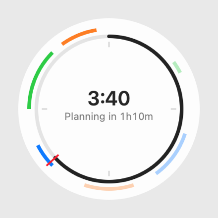
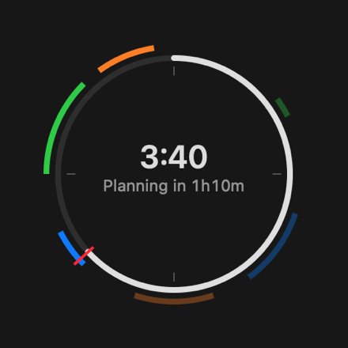
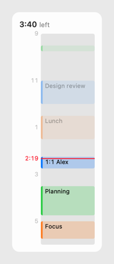
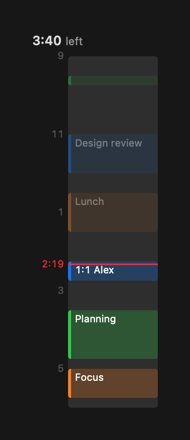

# BmoCal

BmoCal is a macOS menu bar app that shows your workday progress and upcoming calendar events at a glance.

- Workday progress bar with time remaining in the day
- Countdown to the next calendar event or reminder
- Configurable workday start/end hours
- Flash menu bar icon on 15-minute warning for upcoming events
- Blocking and system notification alerts
- Supports multiple calendars and reminder lists
- Optional desktop widgets, a round workday clock and a vertical timeline bar, that you can drag anywhere and reset from the menu bar

## Demo

The round workday widget and the vertical timeline widget, in light and dark mode.

| Light                                                                                              | Dark                                                                                             |
| -------------------------------------------------------------------------------------------------- | ------------------------------------------------------------------------------------------------ |
|        |        |
|  |  |

## Building

Open `BmoCal.xcodeproj` in Xcode and build (⌘B) or run (⌘R).

Requires macOS and Xcode — no external dependencies or package manager.

## Install

1. Download `BmoCal.zip` from the [latest release](https://github.com/justanotherkevin/BmoCal/releases/latest).
2. Unzip it and move `BmoCal.app` to the `/Applications` folder.
3. Open `BmoCal.app`.
4. macOS will block it because the app is not notarized. Open System Settings, go to Privacy & Security, scroll down, click "Open Anyway", and confirm.
5. Grant calendar access when asked.

If you prefer the terminal, you can run this command instead of step 4:

```
xattr -cr /Applications/BmoCal.app
```

## Making a release

1. In Xcode, choose Product > Archive. Then choose Distribute App > Custom > Copy App. You can also build the Release configuration with `xcodebuild`.
2. Zip the app with `ditto`, which keeps the signature intact:

```
ditto -c -k --keepParent BmoCal.app BmoCal.zip
```

3. Create a GitHub release with a tag that matches the app version, for example `v2.2.4`, and attach `BmoCal.zip`. The app checks this page once a day and shows an update menu item when a newer release exists, so the tag must match the version format.

Do not commit the zip file to the repository.

## Credits

BmoCal is inspired by NextEvent, a macOS menu bar app made by Mazookie.

## License

Released under the [MIT License](LICENSE).
