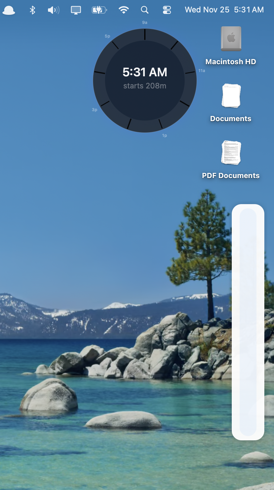

# BmoCal

BmoCal is a macOS menu bar app that shows your workday progress and upcoming calendar events at a glance.

- Workday progress bar with time remaining in the day
- Countdown to the next calendar event or reminder
- Configurable workday start/end hours
- Flash menu bar icon on 15-minute warning for upcoming events
- Blocking and system notification alerts
- Supports multiple calendars and reminder lists
- Optional desktop widgets, a round workday clock and a vertical timeline bar, that you can drag anywhere and reset from the menu bar

## Demo

## Building

Open `BmoCal.xcodeproj` in Xcode and build (⌘B) or run (⌘R).

Requires macOS and Xcode — no external dependencies or package manager.

## License

Released under the [MIT License](LICENSE).
